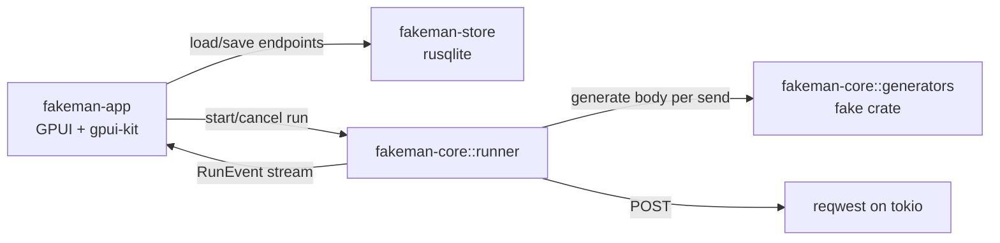

# fakeman — Implementation Plan

fakeman is a desktop API client, styled after Postman, whose twist is that request fields are not typed in by hand: each field is bound to a fake-data generator (for example `person.firstName`), and a fresh value is generated every time a request is sent. A request can be sent once or N times, with an optional delay between sends.

This document describes the target architecture and the phases to build it in. Each phase ends in something runnable or testable, so progress can be checked at every step.

## 1. Goals and non-goals

**In scope for v1**

- A sidebar listing all saved endpoints, with create, rename, duplicate, delete, and search.
- A main editor with a URL input, a Send button, a body-format switch (JSON or form-urlencoded), and a table of body fields.
- Each field has a name and a generator chosen from a searchable dropdown, plus optional generator parameters (for example a number range).
- A static-value generator, so a field can also carry a fixed value.
- Static request headers (key/value, toggleable), because almost every real endpoint needs at least `Authorization` or `Content-Type`.
- Run settings per endpoint: send count N (default 1) and delay between sends in milliseconds (default 0).
- A response panel showing status, latency, response headers, and pretty-printed body, and, for N > 1, a run log with one row per request that includes the exact payload that was generated for it.
- Cancelling a running batch.
- Everything persisted in SQLite.

**Out of scope for v1** (candidates for later phases)

- Methods other than POST. The data model stores the method anyway, so adding a dropdown later stays cheap.
- Multipart forms and file uploads. These are permanently out of scope, not just deferred.
- Arrays in generated bodies.
- Concurrent sending. Requests are always sent one at a time, which is what makes the delay meaningful.
- Environments/variables, auth helpers, scripting, collections/folders, cloud sync.
- Linux as a supported platform. The target platforms are Windows and macOS.

## 2. Technology choices

| Concern | Choice | Why |
| --- | --- | --- |
| Language | Rust (stable, edition 2024) | Requirement. |
| GUI | [GPUI](https://github.com/zed-industries/zed/tree/main/crates/gpui) | Requirement. GPUI is not published as a stable crate; it comes in through gpui-kit as the `gpui-pre` snapshot that gpui-kit pins, so fakeman pins gpui-kit to a git revision and never depends on GPUI directly. |
| Components | [gpui-kit](https://github.com/longbridge/gpui-kit) (formerly gpui-component) | Provides input, select/dropdown, table, tabs, resizable panels, sidebar, theming, and a code editor/viewer for JSON. It pins its own GPUI revision, so fakeman uses **the GPUI revision gpui-kit pins** rather than choosing one independently. |
| Fake data | [`fake`](https://crates.io/crates/fake) 5.x | The established Rust port of the Faker idea, with names, addresses, internet, company, lorem, phone, dates, UUIDs, and locales. |
| HTTP | `reqwest` (rustls, json) on a dedicated `tokio` runtime | Mature and async. GPUI has its own executor, so HTTP runs on a tokio runtime owned by the core and results are streamed back to the UI over a channel. |
| Database | `rusqlite` with the `bundled` feature, `rusqlite_migration` for schema versions | No system SQLite needed on Windows; migrations are plain SQL kept in the repo. |
| JSON | `serde`, `serde_json` | Body building, parameter storage, pretty printing. |
| Paths | `directories` | Puts the database in the OS data directory (`%APPDATA%\\fakeman\\fakeman.db` on Windows, `~/Library/Application Support/fakeman/fakeman.db` on macOS). |
| Errors / logs | `thiserror` in libraries, `anyhow` in the app, `tracing` | Standard. |
| Tests | `cargo test`, `wiremock` for HTTP, in-memory SQLite | Core and storage are testable without opening a window. |

## 3. Architecture

The code is a Cargo workspace with three crates, so that everything except the UI can be developed and tested headlessly:

```
fakeman/
├─ Cargo.toml                 # workspace
├─ crates/
│  ├─ fakeman-core/           # domain model, generator catalog, body builder, runner
│  ├─ fakeman-store/          # SQLite schema, migrations, repositories
│  └─ fakeman-app/            # GPUI binary: windows, views, state, wiring
└─ docs/
   └─ PLAN.md
```



### 3.1 Domain model (`fakeman-core`)

```rust
struct Endpoint {
    id: EndpointId,
    name: String,
    method: Method,            // POST only in v1
    url: String,
    body_format: BodyFormat,   // Json | FormUrlEncoded
    headers: Vec<Header>,
    fields: Vec<Field>,
    run: RunSettings,
}

struct Header { key: String, value: String, enabled: bool }

struct Field {
    name: String,              // JSON key, e.g. "firstname"
    generator: GeneratorRef,   // e.g. key "person.firstName" + params
    enabled: bool,
}

struct GeneratorRef { key: String, params: serde_json::Value }

struct RunSettings { count: u32, delay_ms: u64 }
```

### 3.2 Generator catalog

The heart of the app is a registry of named generators. Each entry has a stable string key (Faker-style, so it reads like `faker.person.firstName` in the UI), a category, a label, an optional parameter schema, and a function that produces a `serde_json::Value`:

```rust
struct GeneratorDef {
    key: &'static str,          // "person.firstName"
    category: &'static str,     // "Person"
    label: &'static str,        // "First name"
    params: &'static [ParamDef],// e.g. min/max for number.int
    generate: fn(&Params, &mut dyn RngCore) -> serde_json::Value,
}
```

Keys are stored in the database, so they are a public contract: once shipped, a key is never renamed, only deprecated. The generator returns a typed JSON value, so `number.int` produces a JSON number and `datatype.boolean` a JSON boolean rather than strings.

The initial catalog (backed by the `fake` crate) covers:

- **Person**: firstName, lastName, fullName, title, jobTitle
- **Internet**: email, safeEmail, username, password (length params), url, domain, ipv4, ipv6, userAgent
- **Phone**: phoneNumber
- **Location**: street, city, zipCode, state, country, countryCode, latitude, longitude
- **Company**: name, buzzword, catchPhrase, industry
- **Lorem**: word, words (count), sentence, paragraph
- **Number / Datatype**: int (min/max), float (min/max/decimals), boolean, uuid
- **Date**: past, future, between (ISO-8601 output)
- **Finance**: creditCardNumber, currencyCode, amount
- **Static**: fixed string, number, boolean, or null

Locale is a single app-wide setting in v1 (default `en`), wired through so that per-field locales can be added later without a schema change.

### 3.3 Body builder and runner

`build_body(&[Field], rng) -> serde_json::Value` turns the enabled fields into a JSON object, generating a fresh value per field. Field names containing dots (`address.city`) are expanded into nested objects. There are no arrays.

The body is then encoded according to the endpoint's `body_format`:

- **JSON**: serialised with `serde_json` and sent with `Content-Type: application/json`. Values keep their JSON types.
- **Form-urlencoded**: sent with `Content-Type: application/x-www-form-urlencoded`. Names are used as written, so `address.city` stays a literal key `address.city` instead of being nested. Values are converted to strings: numbers and booleans by their JSON text, and null as an empty string.

A user-defined `Content-Type` header overrides the default, which keeps an escape hatch for APIs that are picky about it.

The runner executes a `RunRequest` (a snapshot of the endpoint at the moment Send is pressed, so edits during a run do not affect it) on the tokio runtime:

1. For `i in 1..=count`: build a new body, send it, record status, latency, headers, body (truncated past a size limit), or the error.
2. Emit a `RunEvent` after each request: `Started { total }`, `RequestFinished { index, payload, outcome }`, `Finished { summary }`, `Cancelled`.
3. Between requests, wait `delay_ms` with a cancellable sleep.
4. A `CancellationToken` stops the batch between requests and aborts the in-flight one.

A failed request (connection refused, timeout, non-2xx) is recorded and the batch continues; a "stop on first error" toggle can be added later.

### 3.4 Persistence (`fakeman-store`)

```sql
CREATE TABLE endpoints (
  id          INTEGER PRIMARY KEY,
  name        TEXT NOT NULL,
  method      TEXT NOT NULL DEFAULT 'POST',
  url         TEXT NOT NULL DEFAULT '',
  body_format TEXT NOT NULL DEFAULT 'json' CHECK (body_format IN ('json', 'form')),
  run_count   INTEGER NOT NULL DEFAULT 1 CHECK (run_count >= 1),
  delay_ms    INTEGER NOT NULL DEFAULT 0 CHECK (delay_ms >= 0),
  sort_order  INTEGER NOT NULL,
  created_at  TEXT NOT NULL,
  updated_at  TEXT NOT NULL
);

CREATE TABLE fields (
  id            INTEGER PRIMARY KEY,
  endpoint_id   INTEGER NOT NULL REFERENCES endpoints(id) ON DELETE CASCADE,
  position      INTEGER NOT NULL,
  name          TEXT NOT NULL,
  generator_key TEXT NOT NULL,
  params_json   TEXT NOT NULL DEFAULT '{}',
  enabled       INTEGER NOT NULL DEFAULT 1
);

CREATE TABLE headers (
  id          INTEGER PRIMARY KEY,
  endpoint_id INTEGER NOT NULL REFERENCES endpoints(id) ON DELETE CASCADE,
  position    INTEGER NOT NULL,
  key         TEXT NOT NULL,
  value       TEXT NOT NULL,
  enabled     INTEGER NOT NULL DEFAULT 1
);
```

Saving an endpoint is one transaction that updates the row and replaces its fields and headers. The store exposes a small repository API (`list_endpoints`, `get_endpoint`, `create`, `save`, `duplicate`, `delete`, `reorder`). A `runs`/`run_requests` history table is deliberately left to a later phase.

An unknown `generator_key` loaded from the database (for example from a newer version) is shown in the UI as "Unknown generator" rather than failing the load.

### 3.5 UI (`fakeman-app`)

Layout, mirroring Postman:

```
┌──────────────┬──────────────────────────────────────────────────┐
│ fakeman  [+] │ [POST] [ https://api.example.com/users     ] [Send]│
│ [search…]    ├──────────────────────────────────────────────────┤
│ ▸ Create user│  Body │ Headers │ Run                              │
│   Signup     │  ┌───┬────────────┬───────────────────┬────────┬─┐ │
│   Orders     │  │ ☑ │ firstname  │ person.firstName ▾│ "Lena" │✕│ │
│              │  │ ☑ │ email      │ internet.email   ▾│ "l@…"  │✕│ │
│              │  └───┴────────────┴───────────────────┴────────┴─┘ │
│              │  [+ Add field]            Preview body ▸           │
│              ├──────────────────────────────────────────────────┤
│              │  Response: 201 Created · 84 ms · 312 B             │
│              │  { "id": 17, ... }          (Run log tab if N > 1) │
└──────────────┴──────────────────────────────────────────────────┘
```

- **Sidebar**: endpoint list with selection, context menu (rename, duplicate, delete), "+" to create, filter input.
- **Request bar**: method badge (fixed to POST), URL input, Send button that turns into Cancel while a run is active.
- **Body tab**: a JSON / Form-urlencoded segmented switch above the field table. The field table has with enable checkbox, name input, generator picker (searchable, grouped by category, shows the key `person.firstName` and a label), a live sample value with a re-roll button, parameter editor for generators that take parameters, delete, and drag-to-reorder. "Preview body" shows one fully generated body in the selected format.
- **Headers tab**: key/value table with enable checkbox.
- **Run tab**: "Send count" number input and "Delay between requests (ms)" input; the delay input is disabled when count is 1.
- **Response panel** (resizable split): for a single send, status, time, size, headers, and the pretty-printed body. For a batch, a progress bar, a summary (succeeded / failed / average latency), and a run log table; selecting a row shows that request's generated payload and response.
- **State**: an `AppState` entity holds the endpoint list and the selected endpoint's editable draft. Edits are saved to SQLite automatically after a short debounce (about 500 ms) and when switching endpoints or closing the window, so there is no Save button and no unsaved state.
- **Keyboard**: Ctrl+Enter send, Ctrl+N new endpoint, Ctrl+D duplicate, Esc cancel run. On macOS, Cmd replaces Ctrl.
- Light and dark themes come from gpui-kit.

## 4. Phases

Each phase lists its deliverable and how it is verified.

### Phase 0 — Project setup and GPUI spike

- Initialise a git repository in the `fakeman` folder and a Cargo workspace with the three crates.
- Add gpui-kit as a git dependency and use the GPUI revision it pins.
- Build a "hello window" that opens a gpui-kit-styled window with a resizable sidebar/main split, a button, and an input, on Windows and macOS.
- Add `rustfmt`, `clippy` (deny warnings), and a CI workflow (GitHub Actions on `windows-latest` and `macos-latest`) that runs fmt, clippy, and tests and builds the app on both.

**Done when** `cargo run -p fakeman-app` opens the window on Windows, the app builds on macOS in CI, and CI is green on both. This phase exists to surface GPUI toolchain issues (MSVC and Windows SDK on Windows; Xcode and Metal on macOS) before any real UI work. Development runs on the Windows PC, so macOS is verified through CI until a Mac is available to run it on.

### Phase 1 — Core domain and generator catalog

- Domain types from 3.1, with `serde` derives.
- Generator registry from 3.2 with the initial catalog, parameter definitions, and validation (for example `min <= max`).
- `build_body` with dotted-name nesting, enabled flags, and duplicate-name detection, plus the JSON and form-urlencoded encoders.
- Seedable RNG so tests are deterministic.

**Done when** unit tests show that every catalog key generates a value of the declared JSON type, that the same seed gives the same body, that two unseeded builds differ, that nested names produce nested objects in JSON, and that form encoding produces flat, correctly escaped `key=value` pairs.

### Phase 2 — SQLite persistence

- Schema and migrations from 3.4, DB file in the OS data directory, foreign keys and WAL enabled.
- Repository API with transactional save.
- Seed a sample endpoint on first launch so the app is never empty.

**Done when** round-trip tests on an in-memory database (create, save with fields and headers, reorder, duplicate, delete with cascade) pass, and a migration test opens a v1 database with the current code.

### Phase 3 — HTTP runner

- tokio runtime owned by core; `reqwest` client with sensible timeouts.
- Runner from 3.3: count, delay, cancellation, per-request events, error capture, response size limit.
- A tiny debug CLI (`cargo run -p fakeman-core --example send`) that loads an endpoint from the database and runs it, to exercise the runner before the UI exists.

**Done when** `wiremock` tests show that N requests arrive with N distinct generated bodies in both formats with the right `Content-Type`, that the delay is respected (within tolerance), that cancel stops the batch, and that network errors and non-2xx responses are reported without aborting the batch.

### Phase 4 — App shell and endpoint sidebar

- `AppState` entity loaded from the store.
- Sidebar: list, select, create, rename, duplicate, delete (with confirm), filter.
- Main area: request bar with URL input bound to the selected endpoint, autosave.

**Done when** endpoints created in the UI survive an app restart and switching endpoints shows each one's URL.

### Phase 5 — Field editor and generator picker

- Body tab field table: add, remove, rename, enable/disable, reorder.
- Generator picker: searchable dropdown grouped by category, showing key and label.
- Parameter editor for parameterised generators, with validation messages.
- Live sample value with re-roll, and a "Preview body" view.
- Body-format switch, Headers tab, and Run tab (count and delay inputs, with validation).

**Done when** a user can build the `firstname → person.firstName` example from the brief, see a sample, re-roll it, and all of it persists.

### Phase 6 — Sending and response view

- Send wires the current draft into the runner; Send becomes Cancel during a run.
- Single-send response view: status, latency, size, headers, pretty JSON (raw text fallback).
- Batch view: progress, summary, run log table, per-row payload and response detail.
- Clear error states: invalid URL, connection refused, timeout, TLS errors.

**Done when** sending to a local echo server (for example `httpbin` in Docker or a wiremock-based test server) shows a different `firstname` on every send, and a run with N = 10 and delay = 500 ms takes roughly 4.5 s, shows ten log rows, and can be cancelled midway.

### Phase 7 — Polish and release

- Keyboard shortcuts, empty states, tooltips, light/dark theme toggle, remembered window size and split positions.
- Import/export of endpoints as JSON (also a cheap backup mechanism).
- App icon and release builds for both platforms via `cargo-packager`: a Windows installer (MSI or NSIS) and a macOS `.app` in a `.dmg`, built in CI.
- macOS code signing and notarization, if you have an Apple Developer account. Without one, the app still runs after the user right-clicks Open the first time.

**Done when** the release builds install and run on a clean Windows machine and a clean Mac.

### Later (post-v1 backlog)

- Other HTTP methods and query parameters.
- Custom templates (`"{{person.firstName}}-{{number.int}}"`).
- "Stop on first error" for batches.
- Request history persisted in SQLite.
- Environments and variables (`{{baseUrl}}`), per-field locale.
- Folders/collections in the sidebar.

## 5. Risks

- **GPUI stability.** GPUI has no stable API and changes with Zed. Pinning to gpui-kit's revision and upgrading both together, deliberately, keeps this contained. Phase 0 exists to find Windows build issues early.
- **gpui-kit coverage.** If a needed widget is missing (for example a drag-reorderable table), a simpler fallback is used first: up/down buttons instead of drag.
- **Async bridging.** Mixing GPUI's executor with tokio is the most likely source of subtle bugs; keeping all networking behind the runner's event channel limits the surface to one place.
- **macOS without a Mac.** Development happens on Windows, so macOS problems show up only in CI until the app is run on a real Mac. Window chrome, Cmd shortcuts, and font rendering should be checked by hand before a release.
- **Catalog keys as contract.** Renaming a key breaks saved endpoints, hence the never-rename rule and the "Unknown generator" fallback.

## 6. Decisions

These were open questions in the first draft and have been decided:

1. **Body format**: JSON and form-urlencoded. Multipart forms and file uploads will not be built.
2. **Nesting**: dotted names produce nested objects in JSON bodies. There are no arrays.
3. **Saving**: autosave.
4. **Methods**: POST only.
5. **Batches**: requests are sent one at a time; there is no concurrency setting.
6. **Platforms**: Windows and macOS.
